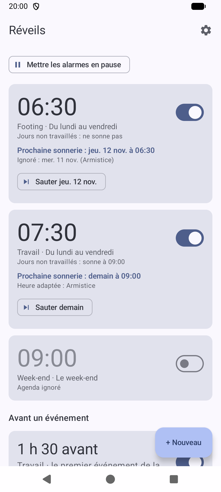
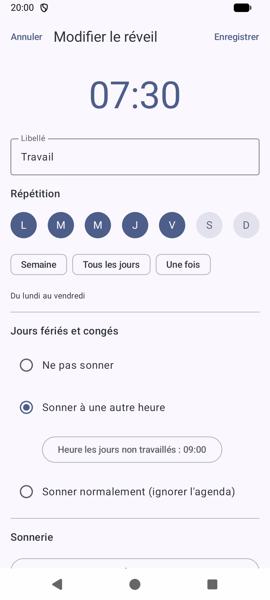
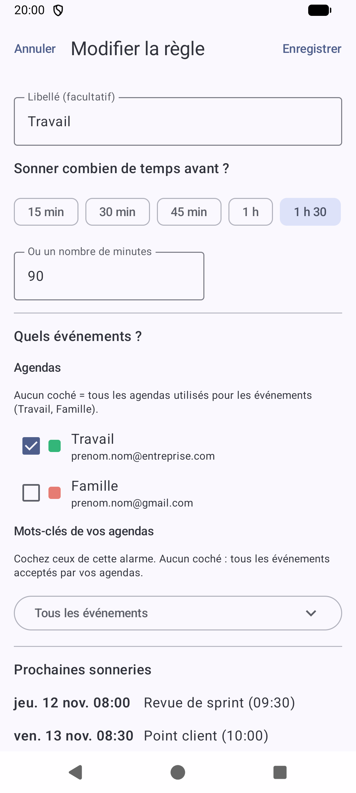
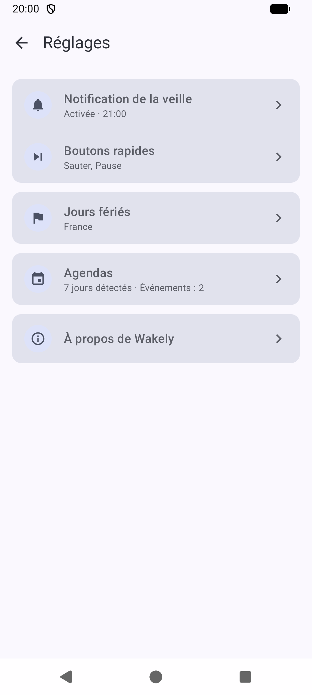
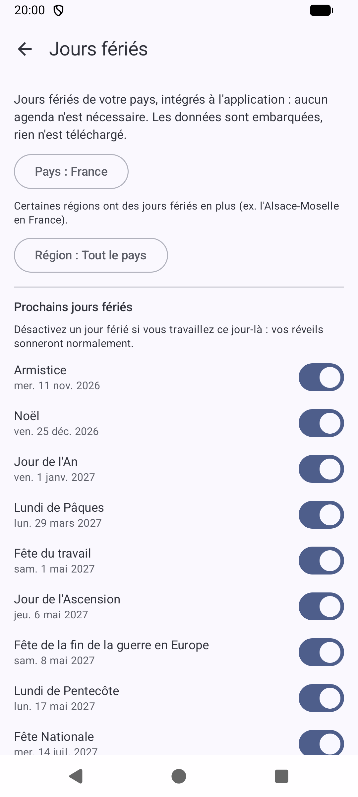
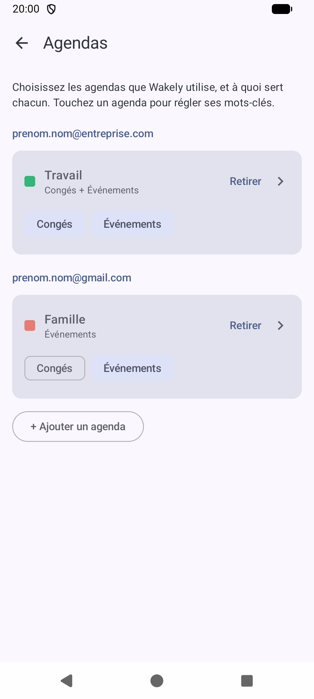
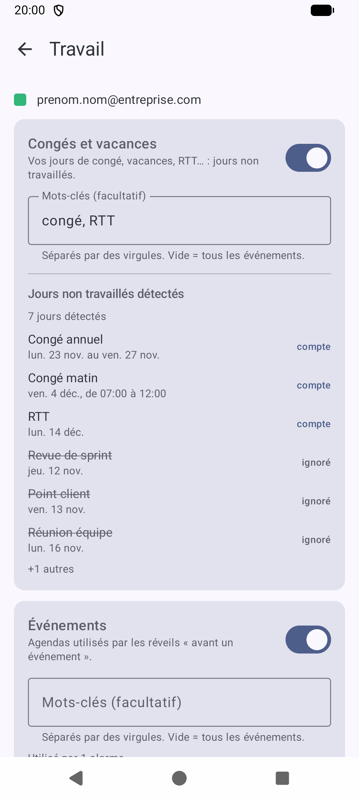
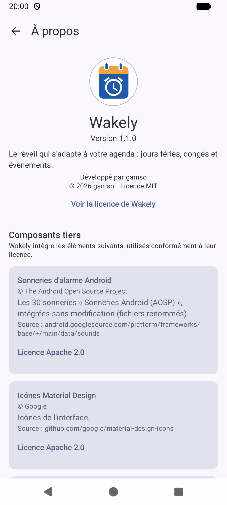

# Wakely

Le réveil Android qui s'adapte à votre agenda : il ne sonne pas (ou sonne plus tard) les jours fériés et les
jours non travaillés, et peut vous réveiller un certain temps avant vos rendez-vous.

Français · [English](README.md)

> Disponible en français et en anglais : Wakely suit la langue de votre téléphone.

  
  
  
  

  
  
  
  

## Fonctionnalités

### Réveils
- **Réveils classiques** : heure, jours de répétition, libellé, sonnerie, snooze réglable ou désactivé.
- **Jours non travaillés** : pour chaque réveil, choisissez « ne pas sonner », « sonner à une autre heure » ou
  « ignorer l'agenda ».
- **Réveils avant un événement** : sonner « X minutes avant » vos événements d'agenda, tous ou seulement ceux qui
  correspondent aux mots-clés cochés.
- **Sauter la prochaine sonnerie** en un geste, depuis la carte du réveil ou depuis la notification du soir.
- **Mettre tous les réveils en pause** jusqu'à une date, pour un voyage par exemple. Ils reprennent tout seuls.
- **Ignorer si je suis déjà levé** : si vous avez déjà marché quelques dizaines de pas avant le réveil, il ne sonne
  pas ce jour-là (le compteur de pas de votre téléphone, rien n'en sort). Cela peut concerner toutes les sonneries,
  ou seulement celles des jours fériés et des congés.
- **Volume progressif et vibration**, réveil par réveil.
- **30 sonneries Android**, les sons d'alarme du téléphone, ou vos propres fichiers audio.
- **Notification du soir** : un résumé des réveils du lendemain, envoyé chaque soir.

### Jours non travaillés
- **Jours fériés intégrés** pour environ 150 pays, avec les jours fériés régionaux (par exemple l'Alsace-Moselle en
  France, ou les Länder allemands) : aucun agenda nécessaire, pas d'Internet, le pays est détecté depuis le
  téléphone.
- **Jours fériés travaillés** : désactivez un jour férié et vos réveils continuent de sonner ce jour-là.
- **Les agendas de votre choix** : tout agenda synchronisé sur le téléphone (Google, Outlook, Samsung...) peut servir
  pour les congés et vacances et pour les événements, chacun avec ses mots-clés. Un aperçu montre les jours non
  travaillés qu'il donne, ce qui facilite le réglage d'un agenda qui mélange congés et réunions.
- **Demi-journées de congé** : un congé saisi avec une heure (une matinée de 07:00 à 12:00) remplace les réveils
  qu'il couvre : celui des jours non travaillés sonne à la place de celui des jours de travail.

## Licence

[MIT](LICENSE) © 2026 gamso. Les composants tiers sont listés dans [THIRD_PARTY_NOTICES.md](THIRD_PARTY_NOTICES.md).
