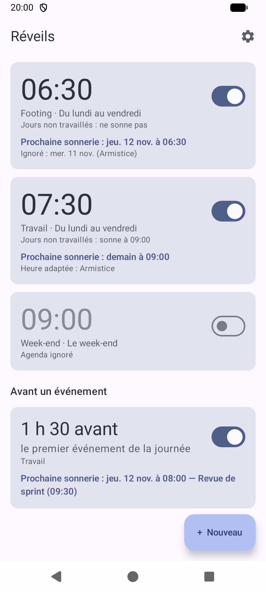
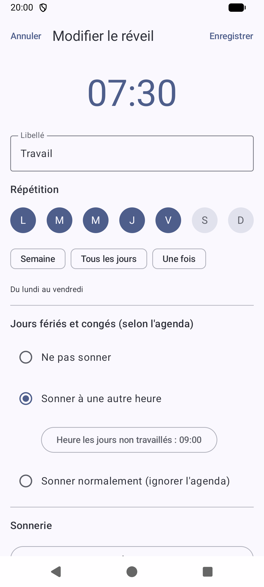
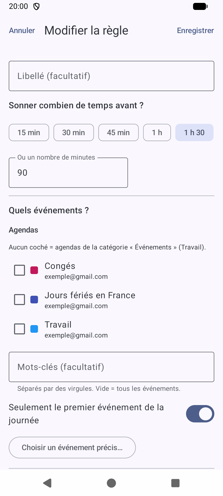
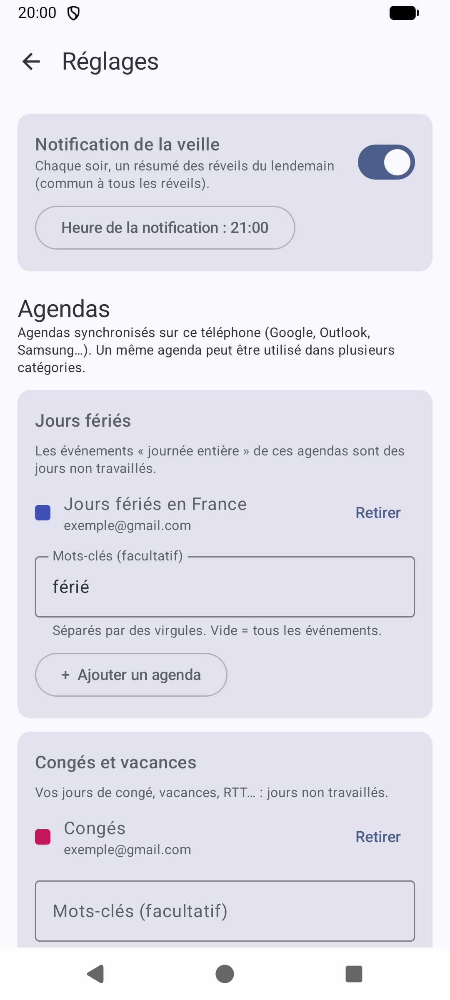

# Wakely

The Android alarm clock that adapts to your calendar: it skips (or rings later on) public holidays and days off,
and can wake you a set time before your appointments.

> Available in English and French: Wakely follows the language of your phone (screenshots below are in French).

  
  
  
  

## Features

- **Regular alarms**: time, repeat days, label, ringtone, adjustable or disabled snooze.
- **Days off**: for each alarm, choose "don't ring", "ring at another time" or "ignore the calendar".
- **Alarms before an event**: ring "X minutes before" the first event of the day, events matching keywords,
  or one specific event.
- **Calendars by category** (leave and vacations, events): every calendar synced on the phone
  (Google, Outlook, Samsung...), with a keyword filter.
- **Built-in public holidays** for about 150 countries, with regional holidays (for example Alsace-Moselle in
  France, or the German states): no calendar needed, no Internet, the country is detected from the phone.
- **Holidays you work on**: switch off a public holiday and your alarms keep ringing on that day.
- **Evening notification**: a summary of tomorrow's alarms, sent every evening.
- **30 Android ringtones**, the phone's own alarm sounds, or your own audio files.

## License

[MIT](LICENSE) © 2026 gamso. Third-party components are listed in [THIRD_PARTY_NOTICES.md](THIRD_PARTY_NOTICES.md).
