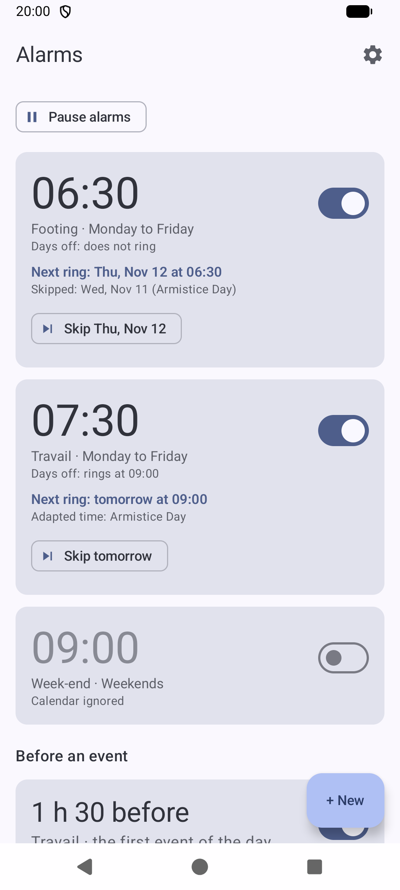
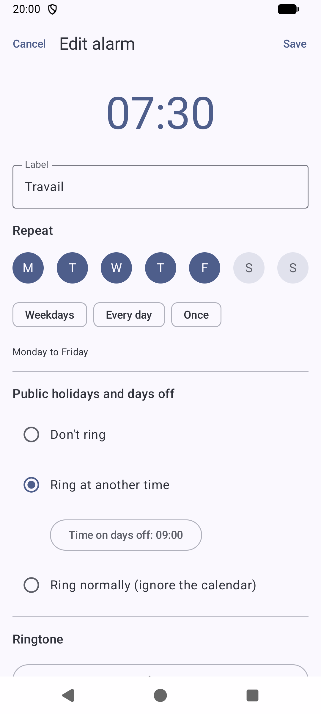
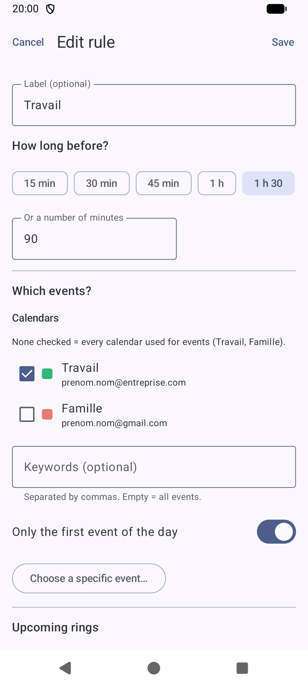
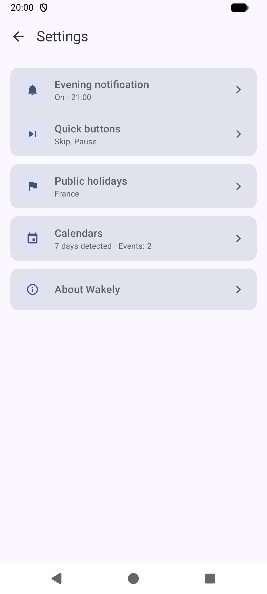
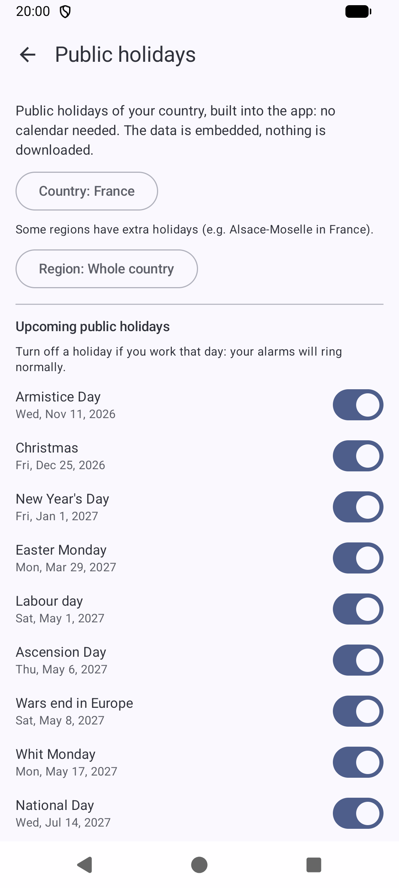
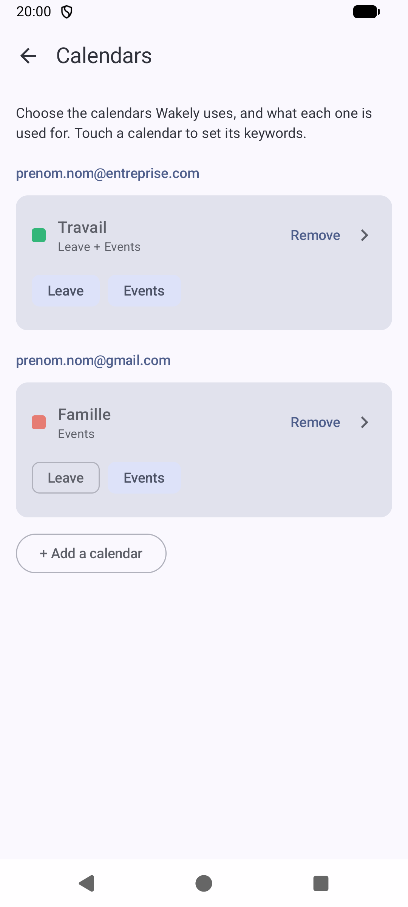
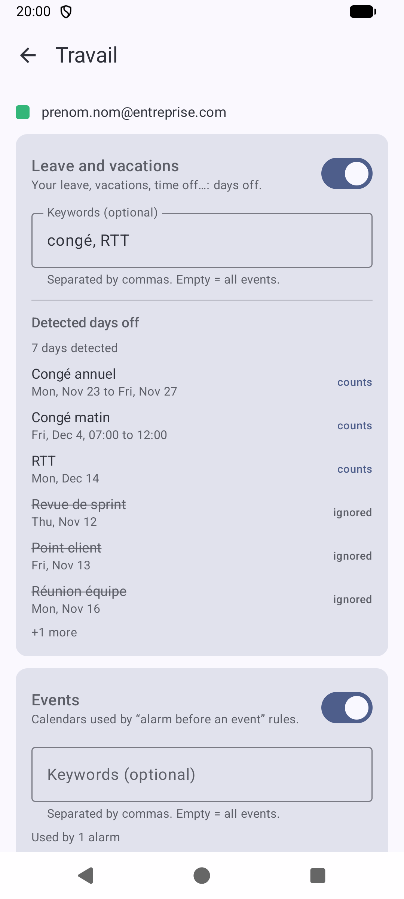
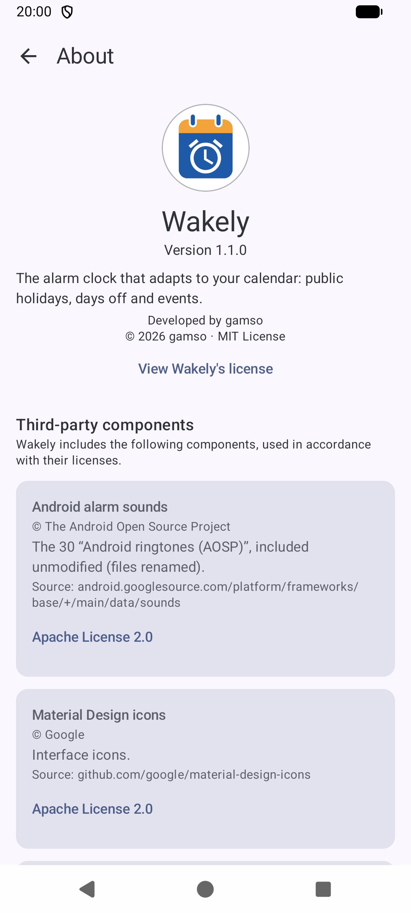

# Wakely

The Android alarm clock that adapts to your calendar: it skips (or rings later on) public holidays and days off,
and can wake you a set time before your appointments.

[Français](README.fr.md) · English

> Available in English and French: Wakely follows the language of your phone.

  
  
  
  

  
  
  
  

## Features

### Alarms
- **Regular alarms**: time, repeat days, label, ringtone, adjustable or disabled snooze.
- **Days off**: for each alarm, choose "don't ring", "ring at another time" or "ignore the calendar".
- **Alarms before an event**: ring "X minutes before" the first event of the day, events matching keywords,
  or one specific event.
- **Skip the next ring** in one tap, from the alarm card or from the evening notification.
- **Pause every alarm** until a date, for a trip for example. They resume by themselves.
- **Skip if I'm already up**: if you have already walked a few dozen steps before the alarm, it does not ring
  that day (the step counter of your phone, nothing leaves it). It can cover every ring, or only the ones of
  public holidays and leave days.
- **Gradual volume and vibration**, alarm by alarm.
- **30 Android ringtones**, the phone's own alarm sounds, or your own audio files.
- **Evening notification**: a summary of tomorrow's alarms, sent every evening.

### Days off
- **Built-in public holidays** for about 150 countries, with regional holidays (for example Alsace-Moselle in
  France, or the German states): no calendar needed, no Internet, the country is detected from the phone.
- **Holidays you work on**: switch off a public holiday and your alarms keep ringing on that day.
- **The calendars you choose**: every calendar synced on the phone (Google, Outlook, Samsung...) can be used for
  leave and vacations and for events, each with its own keywords. A preview shows the days off it gives, so a
  calendar that mixes leave and meetings is easy to tune.
- **Half days off**: a leave entered with a time (a morning off, 07:00 to 12:00) replaces the alarms it covers, so
  the alarm for days off rings instead of the one for working days.

## License

[MIT](LICENSE) © 2026 gamso. Third-party components are listed in [THIRD_PARTY_NOTICES.md](THIRD_PARTY_NOTICES.md).
